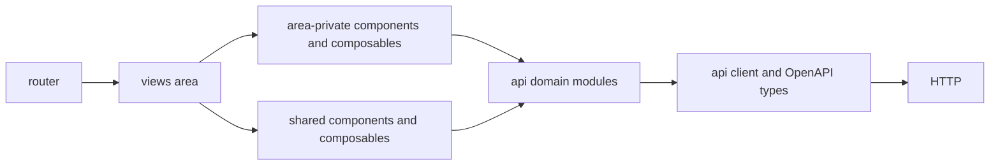
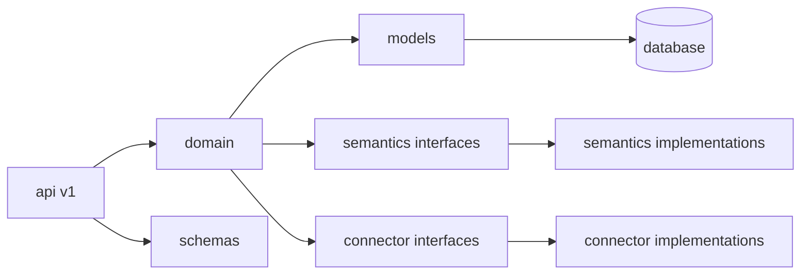

# 应用架构与目录约定

这份约定定义模块放置位置、依赖方向和渐进演进方式。代码风格、API 契约、国际化、测试和安全要求仍分别以对应约定为准。

## 1. 适用范围与演进原则

- 新增模块、跨页面复用、目录调整和实质性重构必须遵守本文。
- 已有代码在修改同一业务能力时渐进迁移；不要为了目录整齐单独搬迁大量文件。
- 先使用现有层和模块。目录随首个真实用途创建，禁止用空目录、占位文件或通用基类预留未来设计。
- 同一业务能力在前端页面、API 模块、后端路由、领域服务、Schema 和测试中使用一致的业务名；例外要在代码或 PR 中说明原因。

## 2. 仓库边界

`web/` 与 `server/` 是业务实现的唯一入口。根目录只保留治理文件、工作区配置和开发工具配置。

`docs/` 存放面向贡献者的设计说明、计划和 ADR；影响长期模块边界、数据模型或外部契约的决定写入 `docs/adr/`，临时调试记录不入库。

`samples/` 只存脱敏的只读样例源库与 seed；`scripts/` 只存可重复执行的开发或维护脚本。二者都不得承载生产业务逻辑。

## 3. 前端目录与职责

```text
web/src/
├── api/                 # HTTP 客户端、OpenAPI 生成类型、按业务域拆分的请求模块
├── components/          # 至少被两个业务域使用的纯展示或通用交互组件
├── composables/         # 至少被两个业务域使用的 Vue 复用逻辑
├── i18n/                # i18n 初始化与运行时配置
├── layout/              # 应用壳、认证壳及其专用子组件；按需创建
├── locales/             # zh-CN 与 en-US 语言包
├── router/              # 路由表、路由元数据与守卫
├── stores/              # 跨路由或需持久化的 Pinia 状态
├── styles/              # 全局样式、设计令牌和基础样式
├── theme/               # UI 库主题适配；按需创建
└── views/<area>/        # 按业务域组织的路由页面及其私有代码
    ├── XxxPage.vue
    ├── components/
    ├── composables/
    └── __tests__/
```

- `views/<area>/` 是业务代码的默认归属。页面私有组件、组合式函数和测试与页面同目录；已有平铺 `views/` 在被实质修改时再迁入对应业务域。
- `components/` 与 `composables/` 只放跨业务域复用的代码。首次复用前留在所属 `views/<area>/`，避免把顶层目录变成无边界的杂物区。
- `layout/` 只管理页面框架和导航出口，不能承载领域请求或业务判断；`theme/` 只管理 UI 库适配，业务样式仍使用 `styles/` 的令牌。
- `stores/` 只保存登录态、语言、主题、布局偏好等跨路由状态。单页筛选、表单草稿和一次性请求状态优先放在页面或 composable 中。
- 新增非首屏路由使用懒加载并声明稳定的 `name` 与 `meta`。路由守卫只处理登录态解析、访问控制和跳转，不加载页面专属领域数据。



依赖只能从页面流向私有代码、共享代码和 API 层。业务请求模块不得导入页面、组件、Pinia、路由或 `vue-i18n`；`api/client.ts` 如需处理认证失效，通过应用启动处注册的回调协作，不直接依赖页面。通用组件通过 props 和 emits 暴露交互，不直接读取页面路由参数或发起业务请求。

### 3.1 前端代码要求

- `api/client.ts` 只负责 HTTP 实例、认证/错误拦截和统一响应解包；每个业务域的请求放在 `api/<area>.ts`。`schema.d.ts` 由 OpenAPI 生成，禁止手改；接口类型遵循 [API 契约](./api-contract.md) 的单一真值源规则。
- 页面负责路由参数、数据编排和展示状态；复杂交互拆到同域私有组件或 composable。组件不得同时承担路由编排、请求和复杂展示三种职责。
- 所有异步页面必须明确 loading、empty、error 和成功状态；路由或筛选条件变更时，旧请求不得覆盖新结果。复用现有 `useAsyncData`，或在同域封装等价的取消逻辑。
- 用户可见文案、错误码和枚举遵循 [国际化](./i18n.md) 与 [API 契约](./api-contract.md)。图标按钮提供可读名称，表单控件关联 label，键盘焦点可见。
- 大列表优先采用服务端分页、筛选和排序；只有分页无法限制 DOM 数量时才引入虚拟滚动。不要为普通列表预先增加缓存层或状态容器。

## 4. 后端目录与职责

```text
server/
├── app/
│   ├── api/v1/          # HTTP 参数、依赖注入、响应与事务边界
│   ├── domain/          # 业务规则和跨资源编排
│   ├── models/          # SQLAlchemy ORM 与领域枚举
│   ├── schemas/         # Pydantic 请求/响应模型
│   ├── semantics/       # RDF、SHACL、OWL 等语义适配接口与实现
│   ├── connectors/      # 外部数据源适配，强制只读
│   └── core/            # 配置、数据库、错误、日志等横切基础设施
├── migrations/          # Alembic 迁移
└── tests/               # pytest 单元、集成与语义测试
```

- 一个业务域新增 API 时，通常同时包含 `api/v1/<area>.py`、`domain/<area>_service.py`、`schemas/<area>.py` 和对应 `tests/test_<area>.py`；模型按聚合或持久化边界合并，不要求一类一文件。
- 路由只处理 HTTP 参数、依赖注入、响应映射和单次写事务；领域服务不能导入 FastAPI 或感知 Request、Response、HTTP 状态码。领域服务可使用 ORM Session 与模型，但不得自行 `commit` 或开启独立事务。
- `schemas/` 只描述传输契约，不能承载 SQL 查询或业务判断；`models/` 只描述持久化映射，不能调用领域服务或 API。路由返回 Pydantic 响应模型，领域服务不拼装 HTTP 字典。
- RDF/SHACL/OWL 依赖只出现在 `semantics/`，外部源库驱动只出现在 `connectors/`。新领域服务依赖 `SemanticBackend` 等稳定接口，由应用边界选择具体实现；既有代码在实质修改时迁移，不做纯目录式重构。
- `core/` 只接纳跨业务域基础设施。业务专属 helper 放回所属领域；禁止新增含混的 `utils.py`、`common.py` 或跨域万能服务。
- 新迁移文件只追加不改写；新增表、列或约束必须能从空库执行到 `head`，并兼容现有 [测试约定](./testing.md)。



`api/v1`、`domain`、`models`、`schemas` 之间不得形成循环导入。跨业务域流程应以用途命名的领域编排服务承接，不能把规则塞进路由、ORM model 或通用 helper。

## 5. 变更验收

提交前，除执行对应的 lint 和测试外，确认以下事项：

- [ ] 新代码位于与其复用范围相符的目录，没有为未来预建目录或抽象。
- [ ] 前端依赖没有绕过 API 层，后端业务规则没有进入路由、Schema 或 ORM model。
- [ ] 页面和请求路径覆盖 loading、empty、error 与权限/不存在等可预期状态。
- [ ] API 类型、错误码、枚举、i18n 与迁移遵循各自的既有契约。
- [ ] 新增测试靠近所属业务域，并覆盖本次变更的行为或边界。
