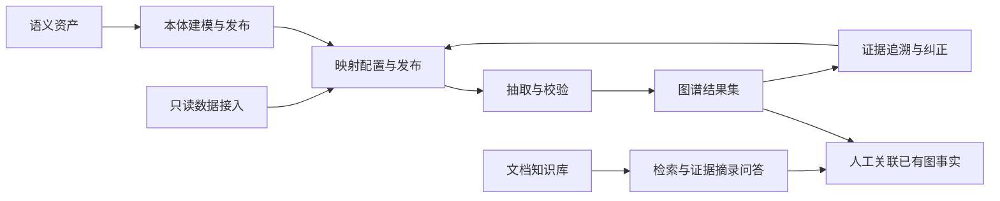

# 知识中台文档中心

核验日期：2026-11-26。适用范围为 `9222236` 基线加当前未提交的 A 风格界面工作区，不代表已发布版本。证据范围见[本轮核验记录](maintenance/verification-2026-11-26.md)。

知识中台把业务概念、数据映射、抽取结果和证据联系起来。结构化数据形成版本化图谱，文档形成可检索的知识库，两者通过明确的证据关联协作。平台当前适合受控环境的业务试点与集成评估；生产采用还需完成目标环境验收。

## 按你的任务开始

| 读者与任务           | 阅读路径                                                                                                                       | 读完可以做什么                               |
| -------------------- | ------------------------------------------------------------------------------------------------------------------------------ | -------------------------------------------- |
| 产品负责人、采购评估 | [产品介绍](product/overview.md) → [功能台账](product/feature-catalog.md) → [能力限制](product/limitations.md)                  | 确定适用场景，区分当前能力与交付缺口         |
| 第一次使用           | [安装与部署](operations/deployment.md) → [快速入门](user-guide/quickstart.md) → [工作台与导航](user-guide/workbench.md)        | 初始化自己的管理员，从样例数据走到图谱与证据 |
| 业务建模与治理       | [建模与治理指南](user-guide/modeling-governance.md)                                                                            | 维护语义资产、组装本体、发布与治理           |
| 数据工程与分析       | [数据到图谱指南](user-guide/data-graph.md)                                                                                     | 配置连接、映射和抽取，定位失败与事实来源     |
| 知识运营与管理员     | [知识库与系统指南](user-guide/knowledge-system.md) → [角色权限](user-guide/roles-permissions.md)                               | 管理文档、模型、用户及审计                   |
| 实施与运维           | [部署](operations/deployment.md) → [配置](operations/configuration.md) → [故障排查](operations/troubleshooting.md)             | 分清环境、迁移、备份与运行边界               |
| 开发与维护           | [架构](development/architecture.md) → [贡献指南](../CONTRIBUTING.md) → [文档同步规范](../.agents/conventions/documentation.md) | 修改功能时识别并同步受影响文档               |

## 业务主线

关键概念见[术语表](product/glossary.md)。业务版本、当前图谱和知识库活动索引是不同对象，不能用同一个“已发布”概念代替。

## 文档怎么判断可信度

- **实现状态**：已实现、部分实现、未实现，描述代码能力；受配置限制的能力写明条件。
- **验证状态**：源码确认、测试存在、本轮执行通过、浏览器实测、未验证分别记录。存在测试文件不等于本轮通过。
- **版本范围**：本轮基于未提交工作区；后续交付更新日期、代码基线及验证记录。
- **历史资料**：[文档盘点](maintenance/document-inventory.md)保留 ADR 和历次报告的时间语义。历史测试数字、临时端口、进程号和截图不作为当前运行承诺。

API 字段和参数以运行服务的 `/openapi.json`、`/docs` 及[生成契约说明](development/architecture.md#接口与契约)为准，操作指南不维护第二份逐字段接口规范。
