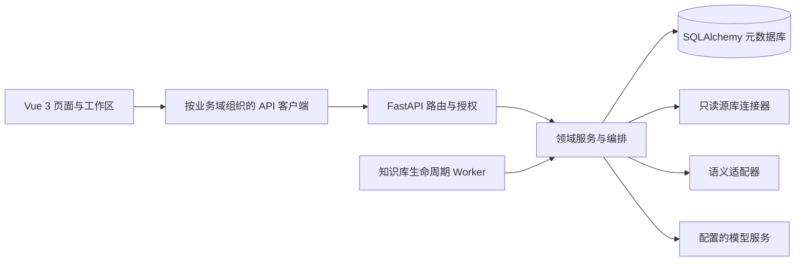

# 架构、契约与开发维护

核验日期：2026-11-26。适用 `9222236` 及当前未提交工作区；结构约束以[项目架构规范](../../.agents/conventions/application-architecture.md)为唯一规范来源。

## 系统组成



前端使用 Vue 3、TypeScript、Vite、Pinia、Vue Router、vue-i18n，组件基于仓库的 `components/ui` 和业务组件层；图谱与本体画布使用自绘 SVG，部分布局计算使用 d3。具体版本以[前端清单](../../web/package.json)为准。

后端使用 FastAPI、Pydantic、SQLAlchemy、Alembic。语义能力由 rdflib、pySHACL 和 owlrl 适配，当前 HTTP 依赖选择 `RdflibBackend`。图事实存储在关系模型中，不能把依赖库存在等同于产品提供任意 SPARQL 查询台或完整 OWL-DL 服务。

## 目录与责任

| 位置                                  | 责任                             | 维护时关注                                                   |
| ------------------------------------- | -------------------------------- | ------------------------------------------------------------ |
| `web/src/views/<area>/`               | 业务页面、专用组件和交互状态     | 对象身份、迟到响应、权限及四态                               |
| `web/src/layout/`、`router/`          | 导航、页面归属、会话路由         | 新增路由同步功能登记与导航说明                               |
| `web/src/api/`                        | API调用与生成类型                | 不绕过统一客户端，不手改schema                               |
| `web/src/components/`、`styles/`      | 共享原语、业务组合、主题token    | 验证真实消费页面，参阅[设计系统](../design-system/README.md) |
| `server/app/api/v1/`                  | HTTP参数、授权和路由事务边界     | 请求与响应契约、异常提交审计                                 |
| `server/app/domain/`                  | 发布、抽取、知识处理等领域逻辑   | 冻结版本、并发、失败回滚与证据                               |
| `server/app/models/`、`schemas/`      | 持久化与传输结构                 | 数据迁移和类型兼容                                           |
| `server/app/connectors/`              | 只读外部数据访问                 | 驱动、只读边界、限时及资源释放                               |
| `server/app/semantics/`               | RDF/SHACL/推理实现               | 能执行的范围及NOT_RUN                                        |
| `server/app/api/knowledge_runtime.py` | 应用生命周期与持久化任务处理     | 启停、取消、失败保留旧索引                                   |
| `docs/`                               | 产品、使用、运维、开发及历史决策 | 本轮持续维护入口见[文档中心](../README.md)                   |

## 接口与契约

服务启动后，`/openapi.json` 是生成接口描述，`/docs` 是交互式接口页面。多数JSON使用 `{code,message,data}` 外壳，错误可能带 `params`；业务域发布等现有例外需核对端点，文件下载等非JSON响应按类型处理。文档不复制整套接口字段，现状与新变更要求见[API规范](../../.agents/conventions/api-contract.md)。

```sh
pnpm -C web gen:api
make check-api
```

生成器从 FastAPI 输出 OpenAPI，再生成 `web/src/api/schema.d.ts`。检查模式比较当前生成结果，不启动应用 lifespan；它检查类型漂移，不证明没有破坏性 API 变化。

当前接口并发机制并不完全统一：资源发布版本与对象编辑修订有不同语义，部分端点接受 If-Match，部分使用请求体修订字段或版本绑定。列表也同时存在数组返回和分页返回；集成时以实际 OpenAPI、请求模块及服务端实现为准，不能假设每个列表都是远程分页。

## 业务不变量

1. 本体发布冻结成员资源版本，映射发布冻结本体版本；重跑历史运行不能偷偷使用上游当前草稿。
2. 校验PASS、VIOLATION、NA、NOT_RUN分别表达真实执行结果，缺依赖不能显示通过。
3. 抽取失败不能移动当前成功结果集；幂等运行、来源追溯与带属性关系身份需保留。
4. 登录和权限由后端执行；菜单隐藏只是界面行为。账号审计和业务资产审计有各自范围。
5. 知识文档重处理失败保留上一活动索引；模型版本或配置变化需防止错误索引发布。

## 开发与验证入口

先读[根规则](../../AGENTS.md)和[贡献指南](../../CONTRIBUTING.md)。现有已授权但未提交改动不属于新任务可随意回滚的基线。

| 命令                               | 验证范围                                            |
| ---------------------------------- | --------------------------------------------------- |
| `make lint`                        | ESLint、vue-tsc、Prettier、Ruff、Mypy、架构边界测试 |
| `make test`                        | 前端Node测试与后端pytest                            |
| `make test-e2e`                    | 隔离API/Vite与Chromium主套件                        |
| `make test-e2e-ai`                 | 本地模型协议夹具，不验证真实模型效果                |
| `make test-e2e-modeling`           | 本体候选确认与草稿应用的专用浏览器套件              |
| `make test-e2e-governance`         | 治理与角色专用浏览器套件                            |
| `make check-api`                   | OpenAPI生成类型是否漂移                             |
| `node scripts/check-i18n-keys.mjs` | 双语key集合是否一致                                 |
| `pnpm run check:docs`              | 文档链接、登记路径、路由/API模块覆盖等结构检查      |
| `pnpm run check:docs:staged`       | 对暂存代码给出功能与文档影响报告                    |

CI当前执行web/server检查，以及main、ai、governance三个E2E入口；modeling专用套件存在本地命令，但没有单独进入当前CI矩阵。不能把本地执行等同远程CI通过。

纯文档修改按[文档同步规范](../../.agents/conventions/documentation.md)执行结构、格式和内容核验；变更检查脚本时验证其行为。业务代码修改仍按项目风险与测试规则执行，不以文档检查替代业务测试。

## 交付与变更

新增或调整功能时，先定位[功能台账](../product/feature-catalog.md)的稳定编号和[机读登记](../product/features.json)，补充源码、测试、入口和用户指南关系。更新操作行为、限制、配置或权限后，记录验证日期和对应代码范围。新功能编号不复用已删除编号；停用功能保留历史说明。

README是导航与启动摘要，操作知识保存在指南，规则只在 `.agents/conventions/` 定义。PR必须说明文档影响，不能以修改任意Markdown替代相关文档同步。
