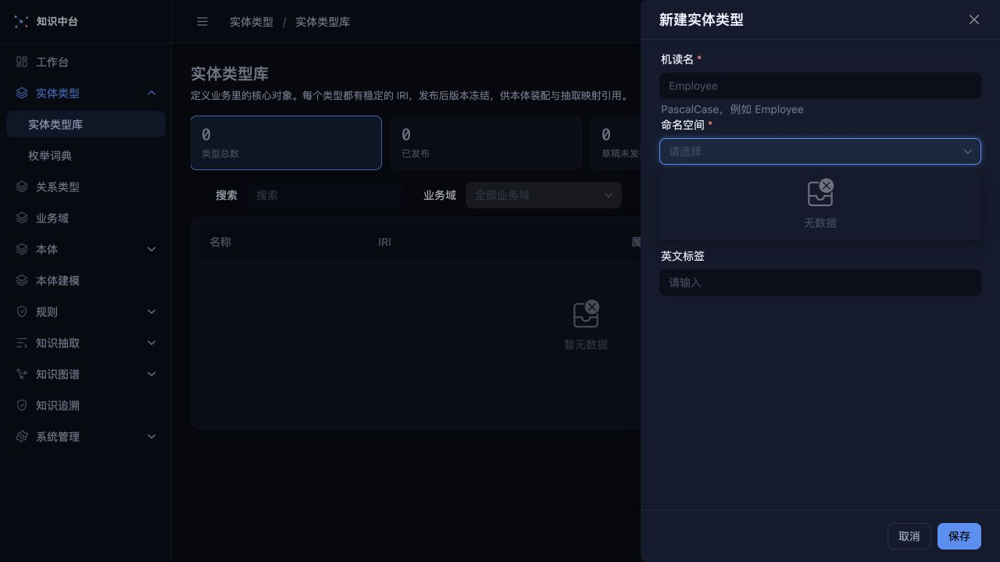

# 知识中台功能完整性核验报告

核验日期：2026-09-25（Asia/Shanghai）  
核验对象：/Users/linyer/Public/Private/knowledge 版本：`5a5e0d3c9d44a3b911de5489192666f32d5ab656`（`docs: 同步主流程结构调整与验收记录`）

本报告按《知识中台功能完整性核验》任务文档执行，回答的是“业务人员能否在不改代码、不手工改库的情况下，从实体类型一路走到五类场景图谱和证据追溯”。代码判断、自动化结果和浏览器实测分开记录；没有执行的项目统一写成“未执行/NOT_RUN”。

## 1. 核验环境与边界

| 项目           | 结果与证据                                                                                                                                                                                                                                                                                                                                                                                                                            |
| -------------- | ------------------------------------------------------------------------------------------------------------------------------------------------------------------------------------------------------------------------------------------------------------------------------------------------------------------------------------------------------------------------------------------------------------------------------------- |
| 工作区         | 核验开始的 `git status --short --branch` 已显示 `D SECURITY.md` 和 `D docs/m4-progress.zh-CN.md`；本轮没有恢复或覆盖。核验收尾时另外观察到 `.agents/AGENTS.md`、`.agents/README.md`、`AGENTS.md`、`CONTRIBUTING.md` 被修改；这些修改不是本轮审计产物，未混入结论基线。`SECURITY.md` 缺失使 `.agents/conventions/security-and-license.md:42-45` 指向的漏洞报告入口失效，作为独立风险记录。                                             |
| 前端构建       | `pnpm -C web build` 通过，Vite 转换 2900 个模块；主 chunk 700.79 kB，超过 500 kB 提示，属于规模化/性能风险。                                                                                                                                                                                                                                                                                                                          |
| lint           | `make lint` 通过：ESLint、vue-tsc、Prettier、Ruff、Mypy；架构检查 109 passed。证据：`/tmp/kgaudit-make-lint.log`。                                                                                                                                                                                                                                                                                                                    |
| 单元/集成测试  | `make test` 通过：前端 Node 测试 64/64，后端 pytest 628/628；后端耗时约 4 分 57 秒，12 个弃用/收集警告。证据：`/tmp/kgaudit-make-test.log`。                                                                                                                                                                                                                                                                                          |
| demo 回归      | `node --test demo/tests/knowledge-graph.test.cjs`：8/8；`node demo/tests/onto-merge.check.cjs`：`ALL CHECKS PASSED`。这些只证明单文件 demo 内存逻辑，不证明 Vue/FastAPI 持久化主流程。                                                                                                                                                                                                                                                |
| i18n           | `node scripts/check-i18n-keys.mjs` 通过，zh-CN/en-US 各 969 个键。                                                                                                                                                                                                                                                                                                                                                                    |
| E2E            | `make test-e2e` 未执行成功：Playwright 固定启动 127.0.0.1:8000 时收到 `Operation not permitted`；同一时间 8000/5173 已有进程，配置又设为 `reuseExistingServer: false`。不能据此宣称 M3 浏览器主流程通过。证据：`/tmp/kgaudit-make-test-e2e.log`、`lsof -nP -iTCP:8000 -iTCP:5173`。                                                                                                                                                   |
| 隔离元数据库   | 以只读方式复制 `server/knowledge.db` 到 `/tmp/kgaudit/completeness-20260925/knowledge.sqlite`。源库快照 SHA-256 为 `1106945907b451714567e25cb3c991f30d74a2ee8ef9d416c8b26b4857540c3e`，快照行数记录在 `before.json`；源库未通过写连接打开。                                                                                                                                                                                           |
| 浏览器隔离运行 | 为避免改动源快照，另建临时元数据库 `/tmp/kgaudit/completeness-20260925/runtime.sqlite`；项目自带 `scripts/seed_admin.py` 仅用于临时管理员引导，业务建模仍只通过界面。Uvicorn 8010 托管构建后的 `web/dist`；登录、工作台和空态路由通过，实体创建的命名空间下拉为空。因采用空库而非源副本运行，不能据此断言存量资产的兼容性。                                                                                                           |
| 场景源库       | `/tmp/kgaudit/completeness-20260925/scenario.sqlite`，由自撰 `scenario.sql` 生成，权限 0444、17 张表；覆盖部门、股权、人物、客商、合同。孤儿部门是刻意保留的隔离样例，`PRAGMA foreign_key_check` 返回 department 99 → 999。该文件不进入仓库。                                                                                                                                                                                         |
| 真实库写入证明 | 核验前后 `server/knowledge.db` 的 SHA-256 均为 `1106945907b451714567e25cb3c991f30d74a2ee8ef9d416c8b26b4857540c3e`，39 张表的行数逐表相同（差异集合 `[]`）；关键表 `model_resource=30`、`business_domain=3`、`ontology=0`、`mapping=0`、`extraction_run=0`、`graph_revision=0`、`graph_triple=0`、`fact_evidence=0`。核验前后逐表快照分别存于 `/tmp/kgaudit/completeness-20260925/before.json` 和 `after.json`；核验后以只读连接复查。 |
| 国标边界       | 已用本地 PDF 提取第 5.2–5.4、6.2、7.3.2、8.2、附录 A 页面核对；报告只引用页码和自撰摘要，不复制标准正文。                                                                                                                                                                                                                                                                                                                             |
| 许可扫描       | Web 许可扫描失败：pnpm 缺少 axios@1.20.0 的 package index；Python 扫描发现 cryptography 48.0.1 的 `Apache-2.0 OR BSD-3-Clause` 不在当前 allow-only 列表。均记为未完成核验，不把 lint 通过当作许可通过。                                                                                                                                                                                                                               |

## 2. 结论速览

### 2.1 主结论

**主流程未贯通。** 最早的界面断点发生在实体类型创建：创建抽屉要求“命名空间”，但当前真实路由没有命名空间登记入口；隔离库 `GET /api/v1/namespaces` 返回 `{code:"KG.OK", data:[] }`，下拉显示“无数据”。因此业务人员无法在空系统内完成第 1 步，后续 11 步不能作为已执行结果。

代码层面，资源版本、映射冻结、失败保护、直接事实证据和四态 A08 已有基础；抽取第 3/4 阶段、派生边、五类场景数据映射、场景图谱形态、语义推荐、视图模板和完整版本追溯仍未形成闭环。

### 2.2 模块统计

统计对象是任务文档第 5 节的 62 个 V-* 项。按任务的严格口径，✅ 需要操作后的界面、结果、刷新持久性及测试/实测证据同时成立；本轮从零流程在第 1 步中断，因此有代码和单测但未完成这组界面验收的项均记 ⚠️，不能当成 ✅。🔌 统计的是 V-* 项本身与上下游无法连接；其他跨项断点另见第 5 节。

| 模块          | 要求项 | ✅ 已实现 | ⚠️ 部分实现 | ❌ 缺失 | 🔌 断点 | ❔ 未验证 |
| ------------- | -----: | --------: | ----------: | ------: | ------: | --------: |
| 实体类型 V-ET |      6 |         0 |           6 |       0 |       0 |         0 |
| 关系类型 V-RT |      5 |         0 |           4 |       1 |       0 |         0 |
| 业务域 V-BD   |      4 |         0 |           3 |       0 |       0 |         1 |
| 本体 V-ON     |      5 |         0 |           5 |       0 |       0 |         0 |
| 设计器 V-DS   |      6 |         0 |           3 |       2 |       1 |         0 |
| 规则 V-RU     |      6 |         0 |           3 |       3 |       0 |         0 |
| 抽取 V-EX     |      8 |         0 |           6 |       2 |       0 |         0 |
| 图谱 V-KG     |     10 |         0 |           5 |       5 |       0 |         0 |
| 追溯 V-TR     |      7 |         0 |           4 |       3 |       0 |         0 |
| 平台 V-PL     |      5 |         0 |           4 |       0 |       0 |         1 |
| **合计**      | **62** |     **0** |      **43** |  **16** |   **1** |     **2** |

### 2.3 五类场景走到哪里

| 场景     | 结论                                                                                                                    |
| -------- | ----------------------------------------------------------------------------------------------------------------------- |
| 部门层级 | 临时源库有四层、多树和孤儿；当前应用没有可执行的部门本体、映射、规则和组织树闭环。                                      |
| 股权架构 | 临时源库有多态股东、三层链、交叉/环路和超 100% 异常；当前没有多态映射、间接持股推导或股权穿透图。                       |
| 人物关系 | 临时源库有项目成员、上下级、亲属、高管；当前抽取不会执行同事/共同参与项目派生，图谱没有人物关系形态。                   |
| 客商     | 临时源库用 customer/supplier 两表及统一社会信用代码覆盖双角色；仓库正式样例没有这两张表，当前没有融合解释图或供应链图。 |
| 合同     | 临时源库有签约方、经办人、项目和补充协议；`samples/seed.sql` 的 ct_contract 没有签约方，当前只有通用合同/项目映射能力。 |

## 3. 五类场景矩阵

结论按“本体 → 源数据 → 映射 → 抽取 → 图谱形态 → 追溯”填写。

| 场景          | 本体                                                                                                                                                                   | 源数据                                                                                                                                                              | 映射                                                                                             | 抽取                                                                                                              | 图谱形态                                                                                                                                      | 追溯                                                                                                                           |
| ------------- | ---------------------------------------------------------------------------------------------------------------------------------------------------------------------- | ------------------------------------------------------------------------------------------------------------------------------------------------------------------- | ------------------------------------------------------------------------------------------------ | ----------------------------------------------------------------------------------------------------------------- | --------------------------------------------------------------------------------------------------------------------------------------------- | ------------------------------------------------------------------------------------------------------------------------------ |
| 部门层级/组织 | ⚠️ 资源模型支持实体和关系，但没有五场景装配记录；关系传递/逆关系的界面证据缺失。证据：`server/app/models/resource.py:49-226`、`server/app/schemas/relation.py:15-72`。 | ⚠️ 临时源库有 4 层、两棵树、孤儿 99；正式样例无 department/position/employment。证据：`samples/seed.sql:21-77`、`/tmp/kgaudit/completeness-20260925/scenario.sql`。 | 🔌 空库无法从界面创建第一个类型（命名空间无入口）；自引用映射没有 UI 实测。                      | ❌ 抽取只执行实体和关系，阶段 3/4 内联且派生计数固定 0。证据：`server/app/domain/extraction_service.py:116-165`。 | ❌ 真实 GraphBrowse 只有类型网格/距离环；无组织树人数汇总、子树筛选、汇报线切换。证据：`web/src/views/graph/components/graphLayout.ts:3-45`。 | ⚠️ 直接事实可查表/行/字段/运行，但没有 parent_id 专属证据模板和全链版本。证据：`server/app/domain/evidence_service.py:28-86`。 |
| 股权架构      | ⚠️ 关联实体可承载属性，但没有多态端点、持股派生规则和比例值域的场景装配证据。证据：`server/app/domain/relation_service.py:135-151`。                                   | ⚠️ 临时源库有 PERSON/ENTERPRISE 股东、三层链、环路及合计 160/105；正式样例无股东表。                                                                                | ❌ 未发现多态端点 discriminator 和按股东类型映射路径；`FK/JUNCTION/ASSOCIATIVE` 不能证明此场景。 | ❌ 无间接持股/实际控制推导，`derived_edge_count=0`。                                                              | ❌ 无 G-06/G-07/G-08/G-09；边也没有比例属性。                                                                                                 | ⚠️ 通用 FactEvidence 存列和行键，但无比例转换链、推导规则和参与事实。                                                          |
| 人物关系      | ⚠️ 员工、项目成员和关联实体资源可表达部分关系；对称/同事/亲属/高管语义未形成完整装配。                                                                                 | ⚠️ 临时源库有 project_member、person_relation、executive_role；正式样例仅有 hr_employee/pm_project_member。                                                         | ⚠️ 项目成员关联表支持 ASSOCIATIVE；高管/亲属表没有正式样例映射和 UI 实测。                       | ❌ 抽取不生成同事/共同参与项目派生边；对称关系去重口径未在真实系统验证。                                          | ❌ 只有通用类型网格/距离环，无力导向人物关系、最短路径和 N 度交互。                                                                           | ⚠️ 直接证据存在；派生关系无法展开来源事实。                                                                                    |
| 客商          | ⚠️ 企业类型和关联实体可表达角色，但客户/供应商角色与 GB/T 扩展语义未完成。                                                                                             | ⚠️ 临时源库 customer/supplier 共享 91310000DEMA000006，供融合验收；正式样例无客户/供应商/交易表。                                                                   | ❌ 未发现按统一社会信用代码跨表融合和双角色保留的编译/运行证据。                                 | ❌ 无聚合金额、笔数、首末日期或双角色规则执行。                                                                   | ❌ 无 G-17 供应链图、G-29 融合解释图。                                                                                                        | ⚠️ 通用证据能指向单一来源行；没有多源 IRI 融合解释。                                                                           |
| 合同          | ⚠️ ct_contract/ct_contract_project 可表达合同和项目；签约方带角色与补充协议未在正式本体装配。                                                                          | ⚠️ 临时源库有 contract_party、handler、parent_contract；正式 `samples/seed.sql:40-77` 的 ct_contract 无签约方字段。                                                 | ⚠️ JUNCTION/ASSOCIATIVE 有代码支持，但合同签约方/角色字段未在 UI 实测。                          | ❌ 无签约方规则、合同事件规则或时间轴抽取阶段。                                                                   | ❌ 无 G-21/G-04/G-15/合同星型和客商联动。                                                                                                     | ⚠️ 合同金额/日期若作为实体属性可查来源列，但签约方角色的证据链未验证。                                                         |

## 4. 图谱形态矩阵（G-01～G-32）

推荐机制的要求是读取当前图谱版本钉住的本体快照，根据自引用/传递、比例/金额、对称、多对多、日期、地理、环路、多来源等语义信号推荐形态。当前代码未发现推荐 API、视图模板模型或改名本体不变性测试，因此“推荐”一列全部为“否”。

| 编号                | 优先级 | 结论 | 推荐触发 | 通用标准缺项                    | 证据                                                                                                                                           |
| ------------------- | ------ | ---- | -------- | ------------------------------- | ---------------------------------------------------------------------------------------------------------------------------------------------- |
| G-01 组织架构树     | P0     | ❌   | 否       | 组织树/人数/子树筛选/证据       | `graphLayout.ts:3-45` 仅类型网格和距离环                                                                                                       |
| G-02 缩进目录树     | P1     | ❌   | 否       | 懒加载、键盘树                  | 无目录树组件；`web/src/views/graph/components/graphLayout.ts:3-45`、`web/src/router/index.ts:111-135`                                          |
| G-03 旭日图         | P2     | ❌   | 否       | 层级度量                        | 无实现；`web/src/views/graph/components/graphLayout.ts:3-45`、`web/src/router/index.ts:111-135`                                                |
| G-04 矩形树图       | P2     | ❌   | 否       | 合同金额钻取                    | 无实现；`web/src/views/graph/components/graphLayout.ts:3-45`、`web/src/router/index.ts:111-135`                                                |
| G-05 圆形打包图     | P2     | ❌   | 否       | 归属嵌套                        | 无实现；`web/src/views/graph/components/graphLayout.ts:3-45`、`web/src/router/index.ts:111-135`                                                |
| G-06 股权穿透图     | P0     | ❌   | 否       | 比例边、双向展开、阈值          | 无持股形态/边属性；`web/src/views/graph/components/graphLayout.ts:3-45`、`web/src/router/index.ts:111-135`                                     |
| G-07 实际控制人链   | P0     | ❌   | 否       | 链上乘积、计算过程              | 派生边计数固定 0；`web/src/views/graph/components/graphLayout.ts:3-45`、`web/src/router/index.ts:111-135`                                      |
| G-08 集团族谱图     | P1     | ❌   | 否       | 控股树                          | 无实现；`web/src/views/graph/components/graphLayout.ts:3-45`、`web/src/router/index.ts:111-135`                                                |
| G-09 环路检测视图   | P1     | ❌   | 否       | 环清单/高亮                     | 无环检测视图；`web/src/views/graph/components/graphLayout.ts:3-45`、`web/src/router/index.ts:111-135`                                          |
| G-10 力导向关系网络 | P0     | ❌   | 否       | 力导向、类型图例、直接/派生线型 | 通用 SVG 边路径存在，布局不是力导向；`web/src/views/graph/components/graphLayout.ts:3-45`、`web/src/router/index.ts:111-135`                   |
| G-11 自我中心网络   | P0     | ⚠️   | 否       | N 度、可调上限；已有截断警告    | `GraphBrowse.vue:26-180` 只有 1/2 度，`graphLayout.ts:24-45` 有距离环                                                                          |
| G-12 关系路径图     | P0     | ❌   | 否       | 最短/全部路径和逐条证据         | 无路径 API/UI；`web/src/views/graph/components/graphLayout.ts:3-45`、`web/src/router/index.ts:111-135`                                         |
| G-13 二部图         | P1     | ❌   | 否       | 两列布局                        | 无实现；`web/src/views/graph/components/graphLayout.ts:3-45`、`web/src/router/index.ts:111-135`                                                |
| G-14 社区聚类图     | P2     | ❌   | 否       | 社区列表/超节点                 | 无实现；`web/src/views/graph/components/graphLayout.ts:3-45`、`web/src/router/index.ts:111-135`                                                |
| G-15 多方关系视图   | P1     | ❌   | 否       | 三端点关联实体显示              | 无实现；`web/src/views/graph/components/graphLayout.ts:3-45`、`web/src/router/index.ts:111-135`                                                |
| G-16 本体模式图     | P0     | ❌   | 否       | 类型/关系规模可点击             | 类型网格不是模式图；`web/src/views/graph/components/graphLayout.ts:3-45`、`web/src/router/index.ts:111-135`                                    |
| G-17 客商供应链图   | P0     | ❌   | 否       | 左右供应链、金额宽度、双角色    | 无实现；`web/src/views/graph/components/graphLayout.ts:3-45`、`web/src/router/index.ts:111-135`                                                |
| G-18 桑基图         | P1     | ❌   | 否       | 流量带和明细                    | 无实现；`web/src/views/graph/components/graphLayout.ts:3-45`、`web/src/router/index.ts:111-135`                                                |
| G-19 弦图           | P2     | ❌   | 否       | 分组密度                        | 无实现；`web/src/views/graph/components/graphLayout.ts:3-45`、`web/src/router/index.ts:111-135`                                                |
| G-20 邻接矩阵       | P1     | ❌   | 否       | 类型/实例矩阵                   | 真实 Vue 无矩阵组件；矩阵只在 demo 回归；`web/src/views/graph/components/graphLayout.ts:3-45`、`web/src/router/index.ts:111-135`               |
| G-21 时间轴         | P0     | ❌   | 否       | 日期泳道/联动                   | 无实现；`web/src/views/graph/components/graphLayout.ts:3-45`、`web/src/router/index.ts:111-135`                                                |
| G-22 履历甘特图     | P1     | ❌   | 否       | 起止日期/重叠                   | 无实现；`web/src/views/graph/components/graphLayout.ts:3-45`、`web/src/router/index.ts:111-135`                                                |
| G-23 时间切片回放   | P1     | ❌   | 否       | 日期滑块/回放                   | 无实现；`web/src/views/graph/components/graphLayout.ts:3-45`、`web/src/router/index.ts:111-135`                                                |
| G-24 图谱版本差异   | P0     | ❌   | 否       | 新增/删除/变化                  | 有版本切换 API，无 diff API/UI；`web/src/views/graph/components/graphLayout.ts:3-45`、`web/src/router/index.ts:111-135`                        |
| G-25 地理分布图谱   | P2     | ❌   | 否       | 地图/区域下钻                   | 无地理属性形态；`web/src/views/graph/components/graphLayout.ts:3-45`、`web/src/router/index.ts:111-135`                                        |
| G-26 证据溯源链图   | P0     | ❌   | 否       | 源连接→表→行→字段→转换→版本链图 | `FactEvidence` 与证据页存在，但没有链图和完整版本字段；`web/src/views/graph/components/graphLayout.ts:3-45`、`web/src/router/index.ts:111-135` |
| G-27 影响面图       | P1     | ❌   | 否       | 反向依赖树/导出                 | 只有资源级 impact 扫描接口，无图谱影响面；`web/src/views/graph/components/graphLayout.ts:3-45`、`web/src/router/index.ts:111-135`              |
| G-28 质量叠加层     | P0     | ❌   | 否       | 叠加红圈/严重度形状             | GraphBrowse 仅显示 quarantine alert，无画布叠加；`web/src/views/graph/components/graphLayout.ts:3-45`、`web/src/router/index.ts:111-135`       |
| G-29 实体融合解释图 | P1     | ❌   | 否       | 多来源贡献/冲突值               | 无多源融合记录/视图；`web/src/views/graph/components/graphLayout.ts:3-45`、`web/src/router/index.ts:111-135`                                   |
| G-30 实体 360 画像  | P0     | ❌   | 否       | 分区跳转各形态                  | 实体详情无 360 分区；`web/src/views/graph/components/graphLayout.ts:3-45`、`web/src/router/index.ts:111-135`                                   |
| G-31 小多图对比     | P2     | ❌   | 否       | 多实体统一比例尺                | 无实现；`web/src/views/graph/components/graphLayout.ts:3-45`、`web/src/router/index.ts:111-135`                                                |
| G-32 中心性排行     | P2     | ❌   | 否       | 中心性计算/定位                 | 无实现；`web/src/views/graph/components/graphLayout.ts:3-45`、`web/src/router/index.ts:111-135`                                                |

分组小计：A（G-01～05）0 已实现/0 部分/5 缺失；B（G-06～09）0/0/4；C（G-10～16）0/1/6；D（G-17～20）0/0/4；E（G-21～24）0/0/4；F（G-25）0/0/1；G（G-26～29）0/0/4；H（G-30～32）0/0/3。合计 0 已实现、1 部分、31 缺失。G-11 只覆盖 1/2 度环形的一部分；G-10 没有力导向、G-16 没有类型级模式图、G-26 没有链图、G-28 没有画布叠加，故判缺失。已发现的通用缺项包括质量叠加、PNG/SVG/CSV 导出、可读版本选择、键盘/主题/双语/窄屏及 1 万实体/5 万事实实测，参见 `web/src/views/graph/GraphBrowse.vue:26-180` 和任务第 4.9 节。

## 5. 闭环断点清单

以下按九环节的发生顺序记录实际上下游断开点；其他效率或验收环境问题列在第 8 节。‘绕路’只描述技术上可能的途径，不视为符合‘只用界面’的验收。

| 顺序 | 断点                           | 当前绕路与证据                                                                                                                                                                                                                                                                               | 需要补齐                                                        |
| ---: | ------------------------------ | -------------------------------------------------------------------------------------------------------------------------------------------------------------------------------------------------------------------------------------------------------------------------------------------- | --------------------------------------------------------------- |
|    1 | 🔌 空库无法从实体类型进入建模  | 8010 浏览器实体创建抽屉的命名空间下拉显示‘无数据’，API 返回空数组；可调用 POST /namespaces 或手工预置，但均违反界面约束。见 web/src/views/ontology/EntityTypes.vue:183-208,247-265；web/src/router/index.ts:39-165。                                                                         | 命名空间登记/选择界面，或可审计的内置命名空间与空库引导。       |
|    2 | 🔌 股权与客商源数据接不上映射  | 现有映射只接 FK/JUNCTION/ASSOCIATIVE 三模式，IRI 基于类型和行键；多态股东、customer/supplier 业务键融合无法按任务场景配置。临时源库虽覆盖输入，绕路需要拆表/改库或改代码。见 server/app/domain/mapping_service.py:145-190、server/app/domain/extraction_service.py:182-185,236-258,347-540。 | 类型判别映射与按统一信用代码融合；保留多个来源行。              |
|    3 | 🔌 规则资产接不上抽取          | 规则库和 SHACL 正反例检查存在，但 start_run 只运行实体/关系映射；第 3/4 阶段标为内联，派生边数固定 0。现可在运行后另调实例校验 API，仍非抽取自动阶段。见 server/app/domain/extraction_service.py:36-113,116-165；server/app/api/v1/validation.py:45-54。                                     | 在冻结本体/映射上执行规则与隔离，保存命中、焦点节点和派生依据。 |
|    4 | 🔌 关联属性接不上图谱边        | 关联资源可保存属性，但 GraphTriple/DerivedEdge 与 graph-view 的边输出只有三元组/类型，不能把持股比例、交易金额、签约角色显示在边上。绕路需看关联实体属性或源表，违反图上事实可读性。见 server/app/models/extraction.py:102-131；server/app/domain/graph_view_service.py:127-137。            | 冻结关联实例的属性及逐字段证据；支持边/中介节点双视图。         |
|    5 | 🔌 图谱数据接不上五种场景形态  | GraphBrowse 只有类型网格和 1/2 度环形布局，G-01/G-06/G-17/G-21 等主形态无入口；绕路只能离开应用做外部可视化。见 web/src/views/graph/components/graphLayout.ts:3-45；web/src/router/index.ts:111-135。                                                                                        | 按场景实现 P0 主形态并接入同一图谱版本、过滤与证据。            |
|    6 | 🔌 本体语义接不上形态推荐/模板 | 未发现推荐服务、理由、模板模型与版本失效提示；改名本体等价性测试因无推荐功能而无法执行。只能人工判断布局。检索 web/src/views/graph、server/app/api/v1、server/app/domain 后，入口仍仅见 GraphBrowse.vue:26-180。                                                                             | 从冻结本体读取语义信号、生成推荐理由并持久化版本化视图模板。    |
|    7 | 🔌 直接/派生事实接不上完整追溯 | FactEvidence 可到源连接/表/行/字段/运行，但没有映射→本体→资源→规则冻结导航；DerivedEdge 也没有规则和参与事实引用。绕路要手工按 ID 查库/API，违反界面追溯要求。见 server/app/models/extraction.py:120-156；server/app/domain/evidence_service.py:28-86,129-173。                              | 扩展证据快照、派生依据与界面链图，并支持反向影响和版本差异。    |

## 6. 逐项核验表

证据中的“静态”表示读代码推断；“实测”表示本轮 8010 浏览器或命令运行。

| 编号    | 要求与实现现状                                                                                                                                                        | 结论 | 证据                                                                                                                                                            |
| ------- | --------------------------------------------------------------------------------------------------------------------------------------------------------------------- | ---- | --------------------------------------------------------------------------------------------------------------------------------------------------------------- |
| V-ET-01 | 列表有统计、搜索、业务域筛选、表格/卡片、属性/关系/状态/版本/更新时间；图谱视图切换未见。                                                                             | ⚠️   | `web/src/views/ontology/EntityTypes.vue:102-174`；静态                                                                                                          |
| V-ET-02 | 六页签和使用关系/规则/域/本体/版本数据已接入。                                                                                                                        | ⚠️   | `server/app/api/v1/types.py:123-129`、`EntityDetail.vue:642-745`；静态                                                                                          |
| V-ET-03 | 数据属性子资源确实有派生 IRI、名称、双语标签/定义、类型、枚举固定版本、可空与默认值；详情表未列 IRI、基数、数值约束和来源条款。                                       | ⚠️   | `server/app/domain/type_service.py:140-190`、`server/app/schemas/type.py:12-34`、`web/src/views/ontology/EntityDetail.vue:457-489`；静态                        |
| V-ET-04 | 可选父类型并显示直接父链；_set_parents 只跳过自父/重复，没有遍历祖先拒绝 A→B→A，也不在详情展开继承属性。                                                              | ⚠️   | `server/app/domain/type_service.py:74-93`、`web/src/views/ontology/EntityDetail.vue:585-588,700-710`；静态                                                      |
| V-ET-05 | 命名空间/IRI 校验和影响扫描有；更名同步关系、域、本体、映射未实现/未证明。                                                                                            | ⚠️   | `server/app/api/v1/namespaces.py:32-73`、`server/app/domain/iri_service.py:55+`；静态                                                                           |
| V-ET-06 | 资源服务使用 If-Match/edit_revision；旧调用可省略 edit token。                                                                                                        | ⚠️   | `server/app/domain/type_service.py:198-214`、`ontology_service.py:210-238`；静态+测试                                                                           |
| V-RT-01 | 端点、基数、角色、逆关系、union/intersection、OWL 特征和互斥校验有。                                                                                                  | ⚠️   | `server/app/schemas/relation.py:15-72`、`relation_service.py:240-330`；独立推理器未验证                                                                         |
| V-RT-02 | 开属性可生成 ASSOC 资源和属性定义；图谱边无属性载荷。                                                                                                                 | ⚠️   | `relation_service.py:135-151`、`models/extraction.py:102-131`                                                                                                   |
| V-RT-03 | 自引用和三种映射模式可表达；多态端点未找到。                                                                                                                          | ⚠️   | `extraction_service.py:347-540`；静态                                                                                                                           |
| V-RT-04 | 列表、搜索、创建、更新、卡片和后端发布 API 有；独立关系详情/版本历史/引用页没有。                                                                                     | ⚠️   | `server/app/api/v1/relations.py:92-146`、`RelationTypes.vue:547-575`                                                                                            |
| V-RT-05 | 没有读取关系语义并推荐图谱形态的服务/API。                                                                                                                            | ❌   | 全仓检索 relation recommendation/view template 无结果；`graphLayout.ts:3-45`                                                                                    |
| V-BD-01 | parent_id、成员、跨域引用、owner_domain_id 有；维护责任域唯一约束没有。                                                                                               | ⚠️   | `server/app/models/domain.py:28-93`、`domain_service.py:47-115`                                                                                                 |
| V-BD-02 | 发布前检查成员、版本、依赖、循环并拒绝。                                                                                                                              | ⚠️   | `server/app/domain/domain_service.py:229-323`；后端测试通过                                                                                                     |
| V-BD-03 | 业务域/继承/业务关系有分层模型；浏览器导出语义未独立实测。                                                                                                            | ⚠️   | `server/app/models/domain.py:72-93`；静态+测试                                                                                                                  |
| V-BD-04 | 资源 ID 可复用；五个场景域和企业/自然人跨域引用未验证。                                                                                                               | ❔   | 无五场景装配 fixture；仅有临时源库                                                                                                                              |
| V-ON-01 | 本体创建、模板、编辑、发布、版本和复制接口/页面有。                                                                                                                   | ⚠️   | `ontology_service.py:36-94`、`api/v1/ontologies.py:80-191`                                                                                                      |
| V-ON-02 | IRI 去重、版本冲突、resource_versions 和规则 pin 在发布快照冻结。                                                                                                     | ⚠️   | `ontology_service.py:98-136,302-373`                                                                                                                            |
| V-ON-03 | 核心核对可输出 PRESENT/MISSING/KIND_MISMATCH/ENTERPRISE_EXTENSION；GB/T 全量目录完整性未证明。                                                                        | ⚠️   | `server/app/domain/core_check_service.py:15-99`                                                                                                                 |
| V-ON-04 | Turtle/JSON-LD 导入导出和 RDF 适配有；独立解析所有属性/约束/依赖未实测。                                                                                              | ⚠️   | `ontology_import_service.py:28-165`、`semantics/ontology_rdf.py`                                                                                                |
| V-ON-05 | 资产层八项四态统计存在，A08=NOT_RUN；但资产检查代码 A05（规则集）和 A06（核心模板）无条件返回 NA。它们与需求验收编号 A05/A06（跨域关系/同一对两条关系）不是同一检查。 | ⚠️   | `server/app/domain/validation_service.py:65-80,194-209,239-252`；静态                                                                                           |
| V-DS-01 | 资源池分组/计数、业务域带、自动布局和布局持久化有。                                                                                                                   | ⚠️   | `Designer.vue:491-506,1100-1120`                                                                                                                                |
| V-DS-02 | 检查器有 label/status/IRI/domain/属性；关系边检查器字段未实测。                                                                                                       | ⚠️   | `Designer.vue:1230-1260`                                                                                                                                        |
| V-DS-03 | 只能从既有资源 ID 组装，没有画布直接建类型/关系/属性。                                                                                                                | ❌   | `Designer.vue` 全文无 create-node/create-edge/create-property 动作                                                                                              |
| V-DS-04 | 校验/发布入口有；模板选择器和本体名面包屑未证明。                                                                                                                     | ⚠️   | `Designer.vue:430-570`；静态+8010 空态                                                                                                                          |
| V-DS-05 | AI 补全/建议无实现，文档列为待决策。                                                                                                                                  | ❌   | `docs/ontology-module-consistency-check.zh-CN.md:227-238`                                                                                                       |
| V-DS-06 | 设计器可装配已有资源，但空库无法从界面创建第一个类型，五场景装配流程从上游断开。                                                                                      | 🔌   | 8010 浏览器 DOM：实体创建抽屉命名空间“无数据”；`web/src/router/index.ts:39-165`                                                                                 |
| V-RU-01 | 标识、双语名、分类、来源依据、作用 IRI、严重度、OWL/SHACL 表达、执行方式、正反例均有字段；本轮未完成带数据的 UI 保存/刷新验收。                                       | ⚠️   | `server/app/schemas/governance.py:19-34`、`server/app/models/governance.py:17-56`；静态                                                                         |
| V-RU-02 | SHACL/RDF 适配和示例入口有；真实 pySHACL 报告通过 UI 未实测。                                                                                                         | ⚠️   | `server/app/semantics/validation_rdf.py`；8010 规则页为空态                                                                                                     |
| V-RU-03 | 抽取没有独立规则阶段，实例校验未由 start_run 调用。                                                                                                                   | ❌   | `extraction_service.py:116-165`                                                                                                                                 |
| V-RU-04 | 空键/端点/转换错误可隔离，但未定义并在抽取时执行部门无环、持股合计、合同签约方、信用代码唯一、YYYYMMDD 五类场景规则。                                                 | ❌   | `server/app/domain/extraction_service.py:116-165`、`server/app/domain/instance_validation_service.py:48-60`；静态，未做场景 UI 复现                             |
| V-RU-05 | DerivedEdge 模型存在，但抽取固定 0，不能定义/执行间接持股或同事派生。                                                                                                 | ❌   | `extraction_service.py:155-165`、`models/extraction.py:120-131`                                                                                                 |
| V-RU-06 | 标准条款与规则来源模块有；每次命中和追溯均可见来源未验证。                                                                                                            | ⚠️   | `git show HEAD:docs/m4-progress.zh-CN.md`（工作区已删除，历史声明仅作线索）、`web/src/views/governance/StandardClauses.vue`；静态                               |
| V-EX-01 | 凭据密文、只读连接器、目录快照与受限预览有；本轮未对真实远程库验证超时、只读权限和连接释放。                                                                          | ⚠️   | `server/app/models/data_access.py:29-63`、`server/app/connectors/sql.py`、`docs/architecture-audit.zh-CN.md:30-33`；静态+既有测试                               |
| V-EX-02 | 五步映射向导、图谱/表格视图、未配置标识、字段转换/空值/预览有。                                                                                                       | ⚠️   | `MappingWizard.vue:95-228,1145-1559`                                                                                                                            |
| V-EX-03 | FK/JUNCTION/ASSOCIATIVE 有；自引用、多态端点、多表业务键融合没有运行证据。                                                                                            | ⚠️   | `extraction_service.py:347-540`                                                                                                                                 |
| V-EX-04 | 幂等指纹、零产出失败、失败不覆盖当前结果有；规则阶段、取消、调度、增量缺失。                                                                                          | ⚠️   | `extraction_service.py:36-113`                                                                                                                                  |
| V-EX-05 | 隔离包含表、行键、字段、原值、转换链、规则 ID；五场景定位未执行。                                                                                                     | ⚠️   | `models/extraction.py:159-174`；后端测试通过                                                                                                                    |
| V-EX-06 | 抽取请求同步执行；无任务、取消、调度、增量、进度 API。                                                                                                                | ❌   | `server/app/api/v1/extraction.py:57-76`                                                                                                                         |
| V-EX-07 | 文档抽取和 AI 映射无实现。                                                                                                                                            | ❌   | 全仓无 document extraction/AI mapping route                                                                                                                     |
| V-EX-08 | 运行报告导出使用字段白名单，不含凭据和原值。                                                                                                                          | ⚠️   | `server/app/schemas/extraction.py:20-34`、`extraction.py:87-103`                                                                                                |
| V-KG-01 | 结果集检索、1/2 度、类型隐藏、直接/派生分栏和多重边路径有；业务域/关系/时间过滤缺失。                                                                                 | ⚠️   | `web/src/views/graph/GraphBrowse.vue:26-180`、`web/src/views/graph/components/graphLayout.ts:47-85`、`server/app/domain/graph_view_service.py:11-35`；静态+单测 |
| V-KG-02 | 五场景主/辅形态没有真实实现。                                                                                                                                         | ❌   | `graphLayout.ts:3-45`                                                                                                                                           |
| V-KG-03 | 缩放/平移、搜索、节点/边截断提示及类型隐藏有；小地图、图谱导出、业务域/时间过滤和形态切换上下文保持缺失或未实测。                                                     | ⚠️   | `web/src/views/graph/components/GraphCanvas.vue`、`web/src/views/graph/GraphBrowse.vue:26-180`；静态                                                            |
| V-KG-04 | 实体列表、详情、出边/入边/派生/证据入口有；五页签完整性未浏览器验证。                                                                                                 | ⚠️   | `GraphEntityDetail.vue`、`GraphEntities.vue`                                                                                                                    |
| V-KG-05 | 报告页面和校验 API 有；焦点节点定位与四态 UI 未完整实测。                                                                                                             | ⚠️   | `GraphReports.vue`、`server/app/api/v1/validation.py`                                                                                                           |
| V-KG-06 | 真实应用无邻接矩阵和组织架构图组件/路由。                                                                                                                             | ❌   | 路由表仅 `graph-browse/entities/evidence/reports`；`router/index.ts:111-135`                                                                                    |
| V-KG-07 | G-01～G-32 中只有通用网格/环形的局部能力，P0 主形态缺失。                                                                                                             | ❌   | 图谱形态矩阵第 4 节                                                                                                                                             |
| V-KG-08 | 无本体语义信号→推荐形态服务，也无改名本体验证。                                                                                                                       | ❌   | 全仓检索无 recommendation/view-template                                                                                                                         |
| V-KG-09 | 无不改代码可配置的视图模板、版本绑定和失效提示。                                                                                                                      | ❌   | 无 view template model/API/UI                                                                                                                                   |
| V-KG-10 | 查询参数保留 graph/center；没有多形态切换和 360 画像分区。                                                                                                            | ⚠️   | `GraphBrowse.vue:68-80`                                                                                                                                         |
| V-TR-01 | 事实可追到 source/table/row/columns/run/evidence_type。                                                                                                               | ⚠️   | `models/extraction.py:134-156`、`evidence_service.py:28-86`                                                                                                     |
| V-TR-02 | 实体属性存来源列；每个属性的转换链未进入 FactEvidence。                                                                                                               | ⚠️   | `extraction_service.py:327-342`                                                                                                                                 |
| V-TR-03 | cfg 有 mapping/onto 版本摘要；FactEvidence 没有完整 mapping/ontology/resource/rule pin。                                                                              | ❌   | `models/extraction.py:134-156`                                                                                                                                  |
| V-TR-04 | 派生边无规则 ID和参与直接事实，且当前没有派生边。                                                                                                                     | ❌   | `models/extraction.py:120-131`                                                                                                                                  |
| V-TR-05 | 没有从源行/映射/本体资源反查产出实体和事实的反向接口。                                                                                                                | ❌   | 全仓检索 reverse impact query 无结果                                                                                                                            |
| V-TR-06 | 隔离来源在证据层有 quarantined 标记和提示。                                                                                                                           | ⚠️   | `evidence_service.py:129-170`                                                                                                                                   |
| V-TR-07 | 可编辑/发布/重跑/切换结果集；没有图谱版本 diff 和全界面修正闭环。                                                                                                     | ⚠️   | `server/app/api/v1/extraction.py:148-168`；无 diff route                                                                                                        |
| V-PL-01 | Dashboard 统计聚合有；工作台待处理问题直达不完整。                                                                                                                    | ⚠️   | `server/app/domain/dashboard_service.py`、`Dashboard.vue`                                                                                                       |
| V-PL-02 | 业务路由统一鉴权；dashboard 使用 current_user，系统用户/角色/日志使用 require_admin；本轮未完成匿名/VIEWER/EDITOR/ADMIN 的逐路由写保护与审计矩阵。                    | ⚠️   | `server/app/main.py:74-97`、`server/app/api/v1/deps.py:64-81`、`server/app/api/v1/dashboard.py:9-20`、`server/app/api/v1/accounts.py:75-103`；静态              |
| V-PL-03 | 两份语言包键集合和 lint 通过；API/角色路径的全量双语运行未测。                                                                                                        | ⚠️   | i18n 脚本 969/969；`.agents/conventions/i18n.md`                                                                                                                |
| V-PL-04 | 前端 64、后端 628、架构 109 和 demo 回归通过；真实 12 步 E2E 未完成。                                                                                                 | ⚠️   | `/tmp/kgaudit-make-test.log`、`/tmp/kgaudit-make-test-e2e.log`                                                                                                  |
| V-PL-05 | Web/Server 扫描未通过：Web 缺 axios index，Python cryptography 的复合许可表达不在脚本 allow-only；owlrl/certifi/pathspec 的历史例外仍需决策记录。                     | ❔   | `scripts/check-web-licenses.mjs:15`、`scripts/check-python-licenses.sh:7`、`docs/architecture-audit.zh-CN.md:35-45`；实测                                       |

### 6.1 Demo 断言到真实系统的对应关系

此表只比较断言意图与真实仓库的测试覆盖；demo 绿色结果不等于真实系统绿色结果。demo 原断言见 demo/tests/knowledge-graph.test.cjs:15-147 和 demo/tests/onto-merge.check.cjs:22-186。

| Demo 断言意图                                                    | 真实系统对应测试                                                                                                                                            | 本轮判定                                                                                                         |
| ---------------------------------------------------------------- | ----------------------------------------------------------------------------------------------------------------------------------------------------------- | ---------------------------------------------------------------------------------------------------------------- |
| 邻域 1/2 度、隐藏类型不作桥接、派生开关、全图孤立点              | server/tests/test_m3_graph_view.py:88-132；web/src/views/graph/**tests**/graphLayout.test.mjs:24-55                                                         | ✅ 对应断言有单测且 make test 通过；仅测试层，不是五场景 UI 验收                                                 |
| 确定性有限布局、平行/反向/派生边不重合、空图                     | web/src/views/graph/**tests**/graphLayout.test.mjs:24-79                                                                                                    | ⚠️ 对应局部布局测试通过；未对每个 demo 中心实体做全组合测试                                                      |
| 派生事实的独立证据、来源不可用提示                               | server/tests/test_m3_evidence.py:219-299；web/src/views/graph/**tests**/graphLayout.test.mjs:57-79                                                          | ⚠️ 证据和绘制的局部断言有；真实抽取 derived_edge_count 固定 0，未覆盖生成派生事实                                |
| HTML 转义与 inline handler 完整性                                | Vue 模板不使用 demo 的 inline handler；make lint、前端测试 64/64                                                                                            | ❔ 未发现同等恶意属性值浏览器注入测试；不能以实现方式不同删掉原安全意图                                          |
| 组织树根为企业、矩阵两级计数、四视图可渲染                       | web/src/views/graph/components/graphLayout.ts:3-45 只保留网格/环；demo/tests/knowledge-graph.test.cjs:94-147                                                | ❌ 真实 Vue 无组织树与矩阵，对应生产测试缺失                                                                     |
| 本体列表/设计面板、模板来源/命名空间/A07/A08                     | server/tests/test_m4_templates.py:100-173,328-362；server/tests/test_m1_validation.py:76-129；web/src/views/ontology/**tests**/selection-lifecycle.test.mjs | ⚠️ 后端和局部渲染有对应测试；本轮 UI 因第 1 步断点无法完成装配                                                   |
| 零产出失败、当前结果集保护、类型入域、枚举固定版本、已有关系挂入 | server/tests/test_m3_extraction.py、test_m3_graph_revision.py、test_m4_enum_dictionaries.py、test_m1_domain.py；e2e/m3-browser-flow.spec.ts:409-525         | ⚠️ 后端有测试，E2E 本轮 0 用例运行；E2E 还通过 API 预建本体与映射（:65-228、:409-413），不满足本任务“全程走界面” |

## 7. 端到端贯通测试记录（12 步）

在 8010 隔离服务的空元数据库中，按界面操作第 1 步时即遇到无法选择命名空间的断点。第 2–12 步未继续执行；它们在此表只记 NOT_RUN，不能把后端单测或页面能打开改写为通过。未执行步骤没有耗时和截图；第 1 步虽有截图及 DOM，开始/结束时间未自动记录，耗时如实标为“未计”。

| 步骤 | 要求                                             | 结论         | 耗时 | 截图/DOM 与 API 证据                                                                                                                                                                                         |
| ---: | ------------------------------------------------ | ------------ | ---- | ------------------------------------------------------------------------------------------------------------------------------------------------------------------------------------------------------------ |
|    1 | 建企业、部门、岗位、自然人、合同、项目类型及属性 | 🔌 / NOT_RUN | 未计 | [step01-namespace-empty.png](./assets/kg-audit-step01-namespace-empty.png)；DOM 显示“命名空间 *”→“无数据”；GET /api/v1/namespaces → KG.OK、data=[]；web/src/views/ontology/EntityTypes.vue:183-208,247-265。 |
|    2 | 建自引用、多态、带属性、对称、传递关系           | ❔ / NOT_RUN | —    | 第 1 步断开；无截图和五场景资源。                                                                                                                                                                            |
|    3 | 建 5 个业务域并装配本体                          | ❔ / NOT_RUN | —    | 无上游场景资源；无截图。                                                                                                                                                                                     |
|    4 | 录入校验/派生规则并发布                          | ❔ / NOT_RUN | —    | 规则页空态打开不等于规则录入；无截图。                                                                                                                                                                       |
|    5 | 接入源库并采集元数据                             | ❔ / NOT_RUN | —    | 数据源空态可见，场景库没有在界面里接入；无截图。                                                                                                                                                             |
|    6 | 配置所有关系模式并发布映射                       | ❔ / NOT_RUN | —    | 五步向导首屏可见，无完整映射；无截图。                                                                                                                                                                       |
|    7 | 运行抽取并核对四类分项计数                       | ❔ / NOT_RUN | —    | 无五场景映射，未产生运行；无截图。                                                                                                                                                                           |
|    8 | 重复运行、核对 IRI/关系/隔离                     | ❔ / NOT_RUN | —    | 后端有幂等测试，但本次未界面执行；无截图。                                                                                                                                                                   |
|    9 | 制造失败运行并核对当前结果                       | ❔ / NOT_RUN | —    | 后端有失败保护测试，但本次未界面执行；无截图。                                                                                                                                                               |
|   10 | 打开五场景主/辅形态及 G-16/24/26/28/30           | ❔ / NOT_RUN | —    | 图谱形态目录缺口见第 4 节；无截图。                                                                                                                                                                          |
|   11 | 在各形态任取事实追溯至字段与冻结版本             | ❔ / NOT_RUN | —    | 没有本次场景事实，完整冻结链缺失；无截图。                                                                                                                                                                   |
|   12 | 从隔离项修正、重跑并对比图谱版本                 | ❔ / NOT_RUN | —    | 无图谱版本差异 UI；无截图。                                                                                                                                                                                  |



现有 e2e/m3-browser-flow.spec.ts:65-228 通过 API 预建本体与映射，:409-525 才从部分界面步骤继续；即使该套件运行通过，也不能替代上述严格的 12 步“全程走界面”验收。本轮 make test-e2e 因端口启动失败，实际执行用例数为 0。

## 8. 问题清单

下表的“实测”指 8010 隔离浏览器；“静态”指代码路径足以证明缺失或未执行，但没有把它伪装成五场景实跑结果。严重度按本次五场景验收口径给出。

| 严重度/编号 | 复现步骤                                                    | 期望                                               | 实际与证据性质                                                                                                                                                                                                                                                       | 涉及文件                                                                                                      |
| ----------- | ----------------------------------------------------------- | -------------------------------------------------- | -------------------------------------------------------------------------------------------------------------------------------------------------------------------------------------------------------------------------------------------------------------------- | ------------------------------------------------------------------------------------------------------------- |
| P0-01       | 空元数据库登录 → 实体类型 → 创建 → 命名空间                 | 通过界面登记/选择命名空间并保存                    | 实测：下拉“无数据”；GET /api/v1/namespaces 返回 KG.OK、data=[]。                                                                                                                                                                                                     | web/src/views/ontology/EntityTypes.vue:183-208,247-265；web/src/router/index.ts:39-165                        |
| P0-02       | 对含规则/模板的本体运行资产层八项校验，查资产检查码 A05/A06 | 适用时应真实执行；未执行应为 NOT_RUN               | 静态：资产检查 A05/A06 无条件返回 NA；与需求验收编号 A05/A06 不同，尚未用 UI 生成样例复现。                                                                                                                                                                          | `server/app/domain/validation_service.py:194-209`                                                             |
| P0-03       | 发布规则后启动抽取并查看命中/派生计数                       | 第 3/4 阶段执行规则、隔离与推导                    | 静态：只遍历实体/关系，derived_edge_count 固定 0；实例校验需另行触发。                                                                                                                                                                                               | server/app/domain/extraction_service.py:116-165；server/app/api/v1/validation.py:45-54                        |
| P0-04       | 映射持股比例/签约角色/交易金额后打开事实边                  | 边标签或关联实体展示属性及证据                     | 静态：GraphTriple/DerivedEdge 和 graph-view 边输出没有属性载荷。                                                                                                                                                                                                     | server/app/models/extraction.py:102-131；server/app/domain/graph_view_service.py:127-137                      |
| P0-05       | 打开部门/股权/人物/客商/合同图谱并切主形态                  | G-01、G-06/07、G-10/12、G-17、G-21 等按语义显示    | 静态：真实布局只有类型网格和距离环；不存在五场景主形态切换。                                                                                                                                                                                                         | web/src/views/graph/components/graphLayout.ts:3-45；web/src/views/graph/GraphBrowse.vue:26-180                |
| P0-06       | 用语义相同、IRI 不同的本体打开形态选择                      | 相同语义得到同类推荐及理由                         | 静态：无推荐/模板服务与 UI，改名不变性用例无法执行。                                                                                                                                                                                                                 | web/src/views/graph/GraphBrowse.vue:26-180；server/app/domain/graph_view_service.py:11-35                     |
| P0-07       | 从图上的直接或派生事实进入证据                              | 到源字段、运行、映射、本体、资源、规则的冻结快照   | 静态：直接事实仅有来源和运行；派生边无规则/参与事实；完整链路不可点开。                                                                                                                                                                                              | server/app/models/extraction.py:120-156；server/app/domain/evidence_service.py:28-86                          |
| P0-08       | 配股权多态股东和客商双表统一信用代码映射                    | PERSON/ENTERPRISE 判别，同码融合一节点且保留双来源 | 静态：映射仅三模式，稳定 IRI 按类型+行键，不含跨表业务键融合契约。                                                                                                                                                                                                   | server/app/domain/mapping_service.py:145-190；server/app/domain/extraction_service.py:182-185,236-258,347-540 |
| P1-01       | 选择关系类型卡片并查版本/引用                               | 独立详情、版本历史、引用处                         | 静态：列表/卡片/发布有，独立详情路由未见。                                                                                                                                                                                                                           | web/src/views/ontology/RelationTypes.vue:520-587；web/src/router/index.ts:67-69                               |
| P1-02       | 建 A→B 后把 A 的父改成 B；为同类型指定两个维护域            | 拒绝继承环、唯一维护域                             | 静态：_set_parents 只跳过自父，owner_domain_id 无唯一约束；两个场景未实跑。                                                                                                                                                                                          | server/app/domain/type_service.py:74-93；server/app/models/domain.py:72-93                                    |
| P1-03       | 用仓库正式样例接入五场景                                    | 覆盖部门、股权、人物、客商及签约合同源表           | 静态：正式 seed 只有六表；本次另用临时场景库，但不能当作项目正式交付。                                                                                                                                                                                               | samples/seed.sql:21-77；samples/README.md:1-27                                                                |
| P1-04       | 在抽取运行中取消/调度/增量并查看进度                        | 状态机真实取消，独立进度和水位                     | 静态：POST /extraction/runs 同步执行，无任务/取消/调度/增量接口。                                                                                                                                                                                                    | server/app/api/v1/extraction.py:57-76                                                                         |
| P1-05       | 对 VIEWER/EDITOR/ADMIN 逐路由读写与发布                     | 401/403/授权/审计全覆盖                            | 部分测试有，核验期间没有完成角色矩阵；不能凭 dashboard/accounts 分路由推断漏洞。                                                                                                                                                                                     | server/app/main.py:74-97；server/app/api/v1/deps.py:65-81；server/app/api/v1/dashboard.py:10-20               |
| P1-06       | make test-e2e                                               | 12 步隔离浏览器套件运行并给出逐步结果              | 环境阻断：固定 8000 监听返回 Operation not permitted，且 8000/5173 已被占用；0 个 E2E 用例执行。                                                                                                                                                                     | playwright.config.ts:7-63；/tmp/kgaudit-make-test-e2e.log                                                     |
| P1-07       | 运行 Web/Python 许可扫描                                    | 依赖清单可审计、许可结论明确                       | Web 缺 axios package index；Python 扫描器拒绝 cryptography 的复合许可证表达。既有 owlrl/certifi/pathspec 例外状态见 docs/architecture-audit.zh-CN.md:35-45；当前脚本白名单已包含相应 SPDX 字符串，但维护者决策记录仍需核对。不能据此断言 cryptography 本身禁止使用。 | scripts/check-web-licenses.mjs:15；scripts/check-python-licenses.sh                                           |
| P1-08       | 核对漏洞报告入口                                            | 仓库存在安全报告路径或等价文件                     | 核验前工作区已有 D SECURITY.md，当前文件缺失且安全约定仍引用；此删除不是本轮审计造成，须由原改动负责人处理。                                                                                                                                                         | .agents/conventions/security-and-license.md:42-45；git status --short                                         |
| P2-01       | 在设计器画布点击新建类型/关系/属性及 AI 建议                | 直接建模与可解释建议                               | 静态：画布只能装配已有资源；AI 补全是 docs/ontology-module-consistency-check.zh-CN.md:227-238 的待决策项。                                                                                                                                                           | web/src/views/ontology/Designer.vue:491-506,1100-1120                                                         |
| P2-02       | 选择 G-14/G-19/G-25/G-31/G-32                               | 聚类、弦图、地理、小多图、中心性形态               | 静态：graphLayout 只有两种布局。                                                                                                                                                                                                                                     | web/src/views/graph/components/graphLayout.ts:3-45                                                            |
| P2-03       | 在 1 万实体/5 万事实下测首屏和帧率                          | 给出上限、截断/分页及可用性能                      | 未执行规模测试；构建输出主 chunk 700.79 kB，不能据此推算图谱性能。                                                                                                                                                                                                   | web/src/views/graph/GraphBrowse.vue:26-180；本轮 build 输出                                                   |
| P2-04       | 在图谱页试小地图、导出和全键盘/双主题/窄屏                  | 可视化通用交互符合任务第 4.9 节                    | 静态未见小地图或图谱 PNG/SVG/CSV 导出；键盘、主题、窄屏未完成五场景实测。                                                                                                                                                                                            | web/src/views/graph/GraphBrowse.vue:26-180；web/src/views/graph/components/GraphCanvas.vue                    |

## 9. 修复建议分批

### 第一批：先打通闭环

1. 补命名空间登记/保护入口，并让空库能在界面内创建第一个实体类型。
2. 将部门、股权、人物、客商、合同场景源库作为正式脱敏样例迁移；保留 customer/supplier 双表和合同签约方表。
3. 在关系模型和 GraphTriple/关联实体之间补属性存储、展示和证据字段。
4. 把规则校验和隔离拆成明确的抽取阶段；派生边必须保存规则 ID、参与直接事实和独立计数。
5. 给 FactEvidence 增加 mapping revision、ontology revision、resource revision、rule revision 的冻结引用，并补反向影响查询。
6. 补完整 12 步 Playwright；固定端口运行需先清理占用或提供显式隔离端口配置，但不能复用未知开发服务。

依赖顺序：1 → 2 → 3/4 → 5 → 6。没有 1 和 2，场景端到端无法开始；没有 3/4/5，图谱和追溯不能验收。

### 第二批：P0 图谱形态与推荐

1. 先实现 G-01、G-06、G-07、G-10、G-11、G-12、G-16、G-17、G-21、G-24、G-26、G-28、G-30。
2. 增加语义信号到形态的推荐服务和推荐理由；以“改名但语义相同”的关系验证不依赖 IRI/表名。
3. 增加版本化视图模板：层级关系、度量、时间、地理、中心类型；本体升级后引用失效要显式提示。
4. 每个形态接入图例、截断/空态、节点/边详情、证据、质量层、PNG/SVG/CSV、键盘/主题/双语和规模上限。

依赖第一批的冻结本体、边属性和派生/证据模型。

### 第三批：P1/P2、推理、任务化与规模化

1. 接入真实完整 OWL 一致性执行器；在接入前继续保持 A08=NOT_RUN。
2. 增加异步任务、取消、调度、增量水位和进度反馈。
3. 补权限矩阵、审计日志端到端验证、许可例外决策和远程数据库实测。
4. 实现关系路径、二部图、时间演化、矩阵、地理、融合解释、社区/中心性等增强形态。
5. 对 1 万实体/5 万事实记录首屏时间、交互帧率、分页/懒加载上限，拆分 700 kB 主 chunk。
6. 在产品决策确定后再做 AI 补全、文档抽取和 AI 映射，保持建议可解释且人工确认后落库。

## 10. 与 demo、设计稿和国标的差异

### Demo 差异

- `demo/知识中台Demo.html` 有 local/all/org/matrix 四种内存模式；`demo/tests/knowledge-graph.test.cjs` 的 8 个断言全部通过，但真实 Vue 应用只有类型网格和距离环，不能把 demo 的组织树/矩阵断言迁移成生产功能。
- demo 的本体合并测试覆盖模板来源、A07/A08、空运行失败和结果集保护；真实应用对应的资源版本和失败保护部分存在，但浏览器从空库开始被命名空间入口阻断。
- demo/企业本体建模demo.html 内含 PartnerRole 和合同角色等示例资源；这些是内嵌数据，不能替代源库抽取和证据追溯。

### 设计稿差异

- design/02-ontology.html 要求统计条、六页签、全页设计器、AI 入口、资源/域计数；当前六页签和部分计数有，AI、画布直接建模、部分检查器语义缺失。
- design/04-extraction.html 要求图谱/表格双视图、未配置项、五步向导和运行失败保护；MappingWizard 的静态结构存在，但五场景映射未实测。
- design/05-graph.html 要求直接/派生图例、实体详情、证据链和四态报告；当前通用图和证据页存在，五类形态、链图、质量叠加和版本差异没有实现。
- design/07-system-auth.html 的账号/角色/审计页面有真实路由，但本轮只完成登录和工作台入口的浏览器实测，未完成逐角色写保护验收。

### 国标差异

GB/T 48000.3—2026 规范的是“标准数字化中的标准本体”；任务里的部门、股权、人物、客商、合同五类企业经营知识属于本次产品验收目标，不能误称为第 6 章和表 1 逐项强制列出的国标核心类型/关系。标准第 9 章允许在保留核心定义的前提下以新命名空间进行行业扩展；是否符合标准核心仍需按核心清单及真实校验另行证明。

已读取 `demo/GBT+48000.3-2026本体建模标准.pdf`：

- PDF 第 9 页（5.2–5.4）要求实体类型、数据属性、对象属性、公理，采用 RDF/RDFS/OWL，使用 Turtle/JSON-LD 序列化并支持 SHACL；第 9–10 页还要求 IRI=命名空间+本地标识符。
- PDF 第 15–16 页表 1 给出核心对象属性和定义域/值域；第 16–17 页要求不相交、唯一性、日期有效性、枚举/范围、功能性、层级和引用区分规则。
- PDF 第 18 页附录 A 要求实体/属性的 IRI、Name、Label、Definition、Domain、Range 和属性类型；第 19 页规定日期数据采用 YYYYMMDD 基本格式。
- 当前系统有命名空间/IRI、RDF 导入导出、SHACL 适配和 A08 四态，但数据属性没有完整属性 IRI/基数/来源条款，场景规则和关系推导未执行，A08 仍须保持 NOT_RUN；因此不能出具“完整符合 GB/T 48000.3—2026”的结论。

### 有意取舍与未交付差异

- 有意分期：`docs/development-plan.zh-CN.md:369` 将组织架构图/邻接矩阵列为 M-10 后续增强，文档/AI 映射列为 L-03/L-04；`docs/ontology-module-consistency-check.zh-CN.md:227-238` 将设计器 AI 和模板选择器保留为产品决策项。这里不把“待决策”本身当作意外回归，但本次任务把五场景主形态提升为验收要求，按当前口径仍是缺口。
- 有意诚实呈现：完整 OWL-DL 推理器未接，`server/app/domain/validation_service.py:239-252` 将 A08 标为 NOT_RUN；不出具完整符合声明。
- 明确遗漏：空库命名空间入口、**资产层校验 A05/A06** 未执行却返回 NA、规则到抽取、边属性、形态推荐、冻结追溯均无可完成的界面闭环，分别见第 5/8 节。这里的资产检查码不能与需求验收 A05（跨域关系）、A06（同一实体对两条业务关系）混同；后两者已有 `server/tests/test_m1_relation.py:94-109,255-299` 后端测试，但未完成本次 UI 验收。

## 附录 A：场景源库与复现边界

完整自撰建表/灌数脚本位于：`/tmp/kgaudit/completeness-20260925/scenario.sql`；SQLite 副本位于：`/tmp/kgaudit/completeness-20260925/scenario.sqlite`。脚本只使用虚构数据，包含以下表：

- 组织：enterprise、department（parent_id 自引用）、employee、position、employment。
- 股权：shareholder（PERSON/ENTERPRISE 多态）、equity_holding（比例、出资额、日期、直接/间接）。
- 人物：project、project_member、person_relation、executive_role。
- 客商：customer、supplier（同一统一社会信用代码双角色）、trade_transaction。
- 合同：contract（parent_contract 自引用）、contract_party、contract_project。

核验摘要：17 张表；部门递归最大深度 4；孤儿 department 99→999；员工 106 有两段任职；持股合计异常为企业 1=160、企业 2=105；双角色信用代码为 91310000DEMA000006；合同 901/902/903 分别有 2/3/2 个签约方。副本权限 0444，连接以 `mode=ro` 打开。该脚本和数据库是审计临时附件，不是正式样例库交付。

场景库完整建表与灌数脚本（仅自撰虚构数据，可用 SQLite executescript 重放）：

```sql
PRAGMA foreign_keys = ON;

-- Read-only completeness-audit source fixture.  Values are deliberately small,
-- deterministic, and include both valid and anomalous records required by the
-- five end-to-end scenario checks.
BEGIN TRANSACTION;

CREATE TABLE enterprise (
  enterprise_id INTEGER PRIMARY KEY,
  unified_credit_code TEXT NOT NULL UNIQUE,
  name TEXT NOT NULL,
  enterprise_kind TEXT NOT NULL CHECK (enterprise_kind IN ('OWN','EXTERNAL'))
);

CREATE TABLE department (
  department_id INTEGER PRIMARY KEY,
  enterprise_id INTEGER NOT NULL REFERENCES enterprise(enterprise_id),
  -- Self-reference is declared; one later inserted invalid row tests quarantine.
  parent_id INTEGER REFERENCES department(department_id),
  code TEXT NOT NULL UNIQUE,
  name TEXT NOT NULL
);

CREATE TABLE employee (
  employee_id INTEGER PRIMARY KEY,
  person_code TEXT NOT NULL UNIQUE,
  name TEXT NOT NULL,
  enterprise_id INTEGER REFERENCES enterprise(enterprise_id)
);

CREATE TABLE position (
  position_id INTEGER PRIMARY KEY,
  code TEXT NOT NULL UNIQUE,
  name TEXT NOT NULL
);

CREATE TABLE employment (
  employment_id INTEGER PRIMARY KEY,
  employee_id INTEGER NOT NULL REFERENCES employee(employee_id),
  department_id INTEGER NOT NULL REFERENCES department(department_id),
  position_id INTEGER NOT NULL REFERENCES position(position_id),
  manager_employee_id INTEGER REFERENCES employee(employee_id),
  start_date TEXT NOT NULL,
  end_date TEXT,
  is_primary INTEGER NOT NULL CHECK (is_primary IN (0,1))
);

CREATE TABLE shareholder (
  shareholder_id INTEGER PRIMARY KEY,
  shareholder_type TEXT NOT NULL CHECK (shareholder_type IN ('PERSON','ENTERPRISE')),
  person_id INTEGER REFERENCES employee(employee_id),
  enterprise_id INTEGER REFERENCES enterprise(enterprise_id),
  CHECK ((shareholder_type='PERSON' AND person_id IS NOT NULL AND enterprise_id IS NULL)
      OR (shareholder_type='ENTERPRISE' AND enterprise_id IS NOT NULL AND person_id IS NULL))
);

CREATE TABLE equity_holding (
  holding_id INTEGER PRIMARY KEY,
  shareholder_id INTEGER NOT NULL REFERENCES shareholder(shareholder_id),
  investee_enterprise_id INTEGER NOT NULL REFERENCES enterprise(enterprise_id),
  ownership_pct NUMERIC NOT NULL,
  subscribed_amount NUMERIC,
  contribution_date TEXT,
  holding_mode TEXT NOT NULL CHECK (holding_mode IN ('DIRECT','INDIRECT')),
  CHECK (ownership_pct >= 0)
);

CREATE TABLE project (
  project_id INTEGER PRIMARY KEY,
  code TEXT NOT NULL UNIQUE,
  name TEXT NOT NULL,
  start_date TEXT,
  end_date TEXT
);

CREATE TABLE project_member (
  project_id INTEGER NOT NULL REFERENCES project(project_id),
  employee_id INTEGER NOT NULL REFERENCES employee(employee_id),
  role TEXT NOT NULL,
  PRIMARY KEY (project_id, employee_id)
);

CREATE TABLE person_relation (
  relation_id INTEGER PRIMARY KEY,
  person_a_id INTEGER NOT NULL REFERENCES employee(employee_id),
  person_b_id INTEGER NOT NULL REFERENCES employee(employee_id),
  relation_type TEXT NOT NULL CHECK (relation_type IN ('RELATIVE','COLLEAGUE','REPORTS_TO')),
  relation_label TEXT,
  CHECK (person_a_id <> person_b_id)
);

CREATE TABLE executive_role (
  role_id INTEGER PRIMARY KEY,
  employee_id INTEGER NOT NULL REFERENCES employee(employee_id),
  enterprise_id INTEGER NOT NULL REFERENCES enterprise(enterprise_id),
  role_name TEXT NOT NULL,
  start_date TEXT,
  end_date TEXT
);

CREATE TABLE customer (
  customer_id INTEGER PRIMARY KEY,
  enterprise_id INTEGER NOT NULL REFERENCES enterprise(enterprise_id),
  unified_credit_code TEXT NOT NULL,
  name TEXT NOT NULL
);

CREATE TABLE supplier (
  supplier_id INTEGER PRIMARY KEY,
  enterprise_id INTEGER NOT NULL REFERENCES enterprise(enterprise_id),
  unified_credit_code TEXT NOT NULL,
  name TEXT NOT NULL
);

CREATE TABLE trade_transaction (
  transaction_id INTEGER PRIMARY KEY,
  own_enterprise_id INTEGER NOT NULL REFERENCES enterprise(enterprise_id),
  partner_enterprise_id INTEGER NOT NULL REFERENCES enterprise(enterprise_id),
  direction TEXT NOT NULL CHECK (direction IN ('PURCHASE','SALE')),
  amount NUMERIC NOT NULL,
  transaction_date TEXT NOT NULL,
  order_no TEXT NOT NULL UNIQUE
);

CREATE TABLE contract (
  contract_id INTEGER PRIMARY KEY,
  contract_no TEXT NOT NULL UNIQUE,
  name TEXT NOT NULL,
  signed_date TEXT NOT NULL,
  amount NUMERIC NOT NULL,
  handler_employee_id INTEGER REFERENCES employee(employee_id),
  parent_contract_id INTEGER REFERENCES contract(contract_id)
);

CREATE TABLE contract_party (
  contract_id INTEGER NOT NULL REFERENCES contract(contract_id),
  enterprise_id INTEGER NOT NULL REFERENCES enterprise(enterprise_id),
  party_role TEXT NOT NULL CHECK (party_role IN ('PARTY_A','PARTY_B','PARTY_C')),
  PRIMARY KEY (contract_id, enterprise_id, party_role)
);

CREATE TABLE contract_project (
  contract_id INTEGER NOT NULL REFERENCES contract(contract_id),
  project_id INTEGER NOT NULL REFERENCES project(project_id),
  PRIMARY KEY (contract_id, project_id)
);

-- Enterprises: OWN is the center for customer/supplier and contract views.
INSERT INTO enterprise VALUES
  (1,'91310000DEMA000001','Acme Holdings','OWN'),
  (2,'91310000DEMA000002','Acme Manufacturing','EXTERNAL'),
  (3,'91310000DEMA000003','Acme Logistics','EXTERNAL'),
  (4,'91310000DEMA000004','Northwind Materials','EXTERNAL'),
  (5,'91310000DEMA000005','Contoso Retail','EXTERNAL'),
  (6,'91310000DEMA000006','Globex Trading','EXTERNAL'),
  (7,'91310000DEMA000007','Cross Share Ltd','EXTERNAL');

-- Four levels, two roots, and one orphan row for quarantine/validation checks.
INSERT INTO department VALUES
  (10,1,NULL,'HQ','总部'), (11,1,10,'OPS','运营中心'),
  (12,1,11,'OPS-IT','信息技术部'), (13,1,12,'OPS-IT-DATA','数据组'),
  (14,1,NULL,'RND','研发中心'), (15,1,14,'RND-AI','AI实验室');

INSERT INTO employee VALUES
  (101,'P-001','林一',1), (102,'P-002','周明',1), (103,'P-003','陈洁',1),
  (104,'P-004','王强',1), (105,'P-005','赵敏',1), (106,'P-006','李雷',1),
  (107,'P-007','韩梅',1);
INSERT INTO position VALUES (1,'CEO','首席执行官'),(2,'MGR','部门负责人'),(3,'ENG','工程师'),(4,'PM','项目经理');
INSERT INTO employment VALUES
  (1001,101,10,1,NULL,'2021-01-01',NULL,1),
  (1002,102,11,2,101,'2022-01-01',NULL,1),
  (1003,103,12,3,102,'2022-03-01',NULL,1),
  (1004,104,13,3,103,'2023-01-01',NULL,1),
  (1005,105,14,2,101,'2022-06-01',NULL,1),
  (1006,106,15,3,105,'2023-02-01','2024-12-31',1),
  (1007,106,12,3,103,'2025-01-01',NULL,1),
  (1008,107,11,4,102,'2024-01-01',NULL,1);

-- Polymorphic holders: people and enterprises; three-level chain, cross-link,
-- cycle (2 -> 7 -> 2), and an intentional total above 100% for rule validation.
INSERT INTO shareholder VALUES
  (201,'PERSON',101,NULL),(202,'PERSON',102,NULL),(203,'ENTERPRISE',NULL,2),
  (204,'ENTERPRISE',NULL,3),(205,'ENTERPRISE',NULL,7),(206,'PERSON',103,NULL);
INSERT INTO equity_holding VALUES
  (3001,201,1,60.0,6000000,'2021-01-10','DIRECT'),
  (3002,202,1,45.0,4500000,'2021-01-10','DIRECT'),
  (3003,203,1,55.0,5500000,'2021-02-01','DIRECT'),
  (3004,204,2,70.0,7000000,'2021-03-01','DIRECT'),
  (3005,205,3,65.0,6500000,'2021-04-01','DIRECT'),
  (3006,203,7,40.0,4000000,'2022-01-01','DIRECT'),
  (3007,205,2,35.0,3500000,'2022-01-02','DIRECT'),
  (3008,206,3,10.0,1000000,'2022-02-02','DIRECT');

INSERT INTO project VALUES
  (401,'PRJ-ERP','ERP升级','2024-01-01','2024-12-31'),
  (402,'PRJ-KG','知识图谱','2025-01-01','2025-09-30');
INSERT INTO project_member VALUES
  (401,102,'负责人'),(401,103,'成员'),(401,105,'成员'),
  (402,103,'负责人'),(402,104,'成员'),(402,107,'成员');
INSERT INTO person_relation VALUES
  (501,101,102,'REPORTS_TO','直属上级'),
  (502,102,103,'COLLEAGUE','同事'),
  (503,103,104,'RELATIVE','兄妹'),
  (504,105,107,'RELATIVE','配偶');
INSERT INTO executive_role VALUES
  (601,101,1,'法定代表人','2021-01-01',NULL),
  (602,102,2,'总经理','2022-01-01',NULL);

INSERT INTO customer VALUES
  (701,5,'91310000DEMA000005','Contoso Retail'),
  (702,6,'91310000DEMA000006','Globex Trading');
INSERT INTO supplier VALUES
  (703,4,'91310000DEMA000004','Northwind Materials'),
  (704,6,'91310000DEMA000006','Globex Trading');
INSERT INTO trade_transaction VALUES
  (801,1,4,'PURCHASE',1200000,'2024-02-01','PO-001'),
  (802,1,6,'PURCHASE',800000,'2024-03-15','PO-002'),
  (803,1,5,'SALE',2100000,'2024-04-20','SO-001'),
  (804,1,6,'SALE',500000,'2024-05-10','SO-002'),
  (805,1,4,'PURCHASE',300000,'2025-01-12','PO-003');

INSERT INTO contract VALUES
  (901,'CT-2024-001','原材料采购合同','2024-02-01',1200000,102,NULL),
  (902,'CT-2024-002','零售供货合同','2024-04-20',2100000,105,NULL),
  (903,'CT-2024-003','采购合同补充协议','2024-06-01',150000,102,901);
INSERT INTO contract_party VALUES
  (901,1,'PARTY_A'),(901,4,'PARTY_B'),
  (902,1,'PARTY_A'),(902,5,'PARTY_B'),(902,6,'PARTY_C'),
  (903,1,'PARTY_A'),(903,4,'PARTY_B');
INSERT INTO contract_project VALUES (901,401),(902,402),(903,401);

COMMIT;

-- One deliberately invalid source row: the self-FK remains visible in metadata,
-- while this row tests whether extraction quarantines an orphan.
PRAGMA foreign_keys = OFF;
INSERT INTO department VALUES (99,1,999,'ORPHAN','孤儿部门');
PRAGMA foreign_keys = ON;
```

## 附录 B：证据索引

- 需求/设计/回归抽取：`/tmp/kgaudit-docs-evidence.md`。
- 实现静态审计：`/tmp/kgaudit-implementation-evidence.md`。
- lint/test/E2E 日志：`/tmp/kgaudit-make-lint.log`、`/tmp/kgaudit-make-test.log`、`/tmp/kgaudit-make-test-e2e.log`。
- 标准 PDF 文本提取：`/tmp/kgaudit/completeness-20260925/standard-extract.txt`；仅用于页码核对，不把标准正文复制进仓库。
- 8010 浏览器实测：隔离服务登录页、工作台、实体类型创建抽屉、规则/数据源/映射/图谱/追溯空态；关键 DOM：登录后菜单含“实体类型、关系类型、业务域、本体、本体建模、规则、知识抽取、知识图谱、知识追溯、系统管理”；实体创建抽屉含“命名空间 *”，下拉结果“无数据”。

最终判定：**当前系统不能在不改代码、不手工改库和不离开系统界面的前提下，完成任务文档要求的九环节和五类知识图谱追溯闭环。**
